# Distributed Data Processing Project

## Overview

This project is the capstone for a graduate distributed systems course covering the Hadoop/Spark big data ecosystem. The goal was to build an end-to-end machine learning pipeline.

The focus of this project was the pipeline and the tools used, not the ML model being run. Because of this, I chose a simple dataset from Kaggle.

**Technologies used:**

- Google Cloud Platform (Compute Engine)
- Docker / Docker Compose
- Apache NiFi
- HDFS
- Hive
- Spark (PySpark)
- HBase
- YARN

## Environment

This project ran a single Compute Engine VM created on Google Cloud. The machine had 4 CPUs and 16 GB of RAM. All applications ran on the same machine via Docker; as one might note, the available resources are insufficient to run all services simultaneously. To resolve this issue, services were brought up and down as needed. 

## Pipeline Walkthrough

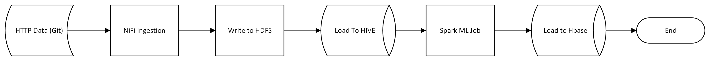

### 1. NiFi Ingestion into HDFS

The flow used three NiFi processors: **InvokeHTTP** to pull the source data from GitHub, **UpdateAttribute** to rewrite the output filename, and **PutHDFS** to land the result in HDFS.

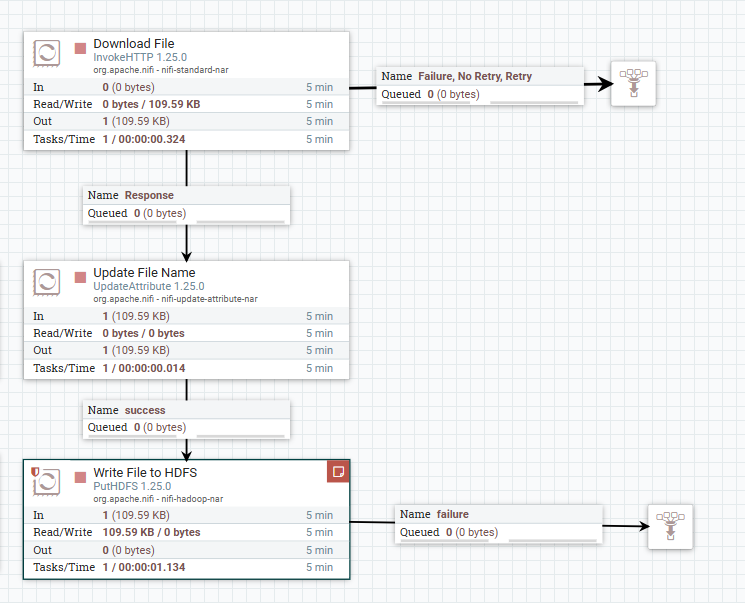
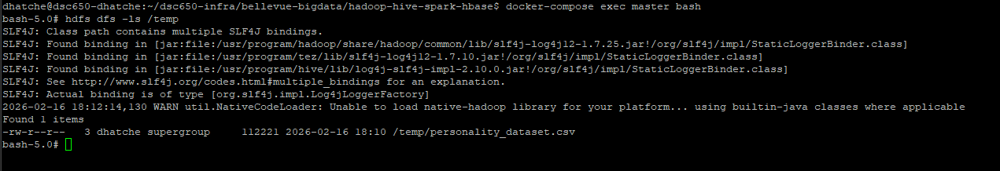

### 2. Hive Managed Table

Loaded the ingested data into a Hive-managed table. At this point in the process, I didn’t see the need to transform the data extensively, as this was a one-off. In a normal pipeline, we would want to insert some data quality checks at this point to ensure the ingested file meets expected standards.

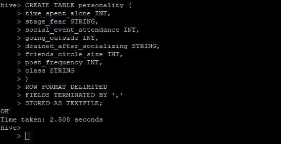
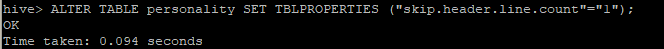
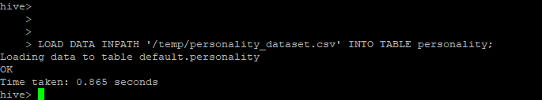
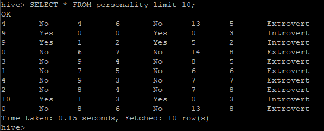

### 3. Environment Setup Across Nodes

One of the benefits of Spark is that work can be split and completed by any number of workers. The following setup was performed to ensure all workers have access to the same Python packages and configuration. We could improve by updating the underlying image used to create the workers to include the needed configuration.

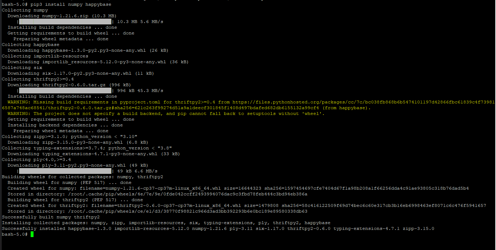
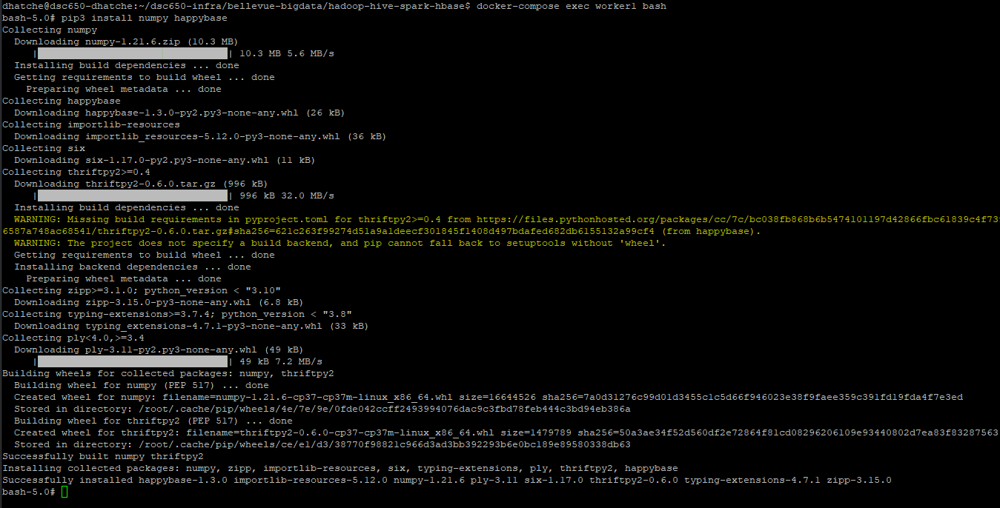
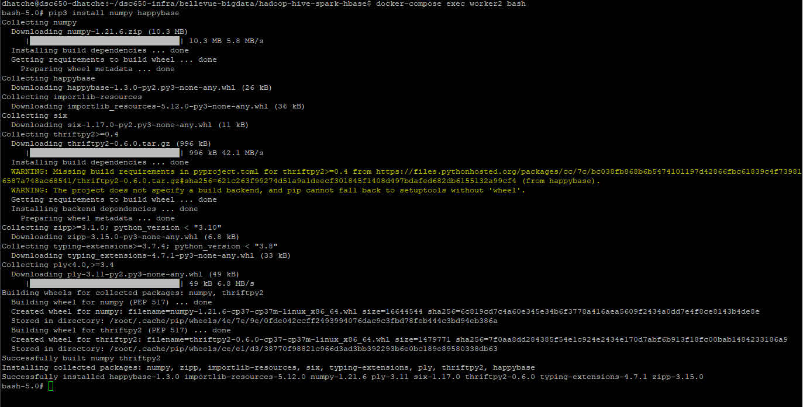
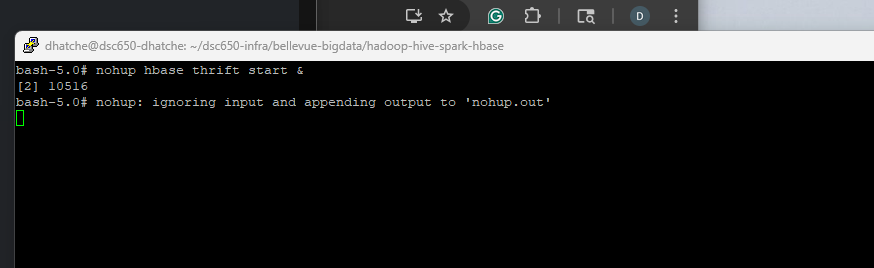

### 4. HBase Table for Model Metrics

Created an HBase table to hold and track model run metrics. I designed the row key (`model_name_datetimestamp`) to be a combination of the model name and the run's date and time stamp. I chose this row key so that the same model run would be stored together, while different runs could be split across shards.   


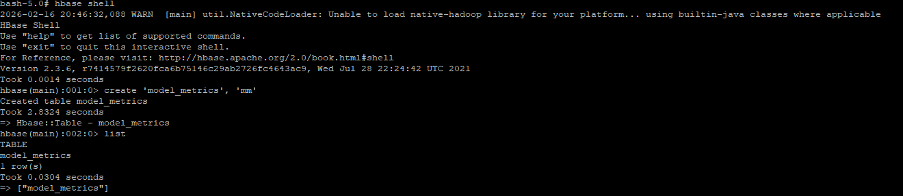
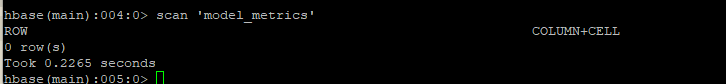

### 5. PySpark Model Training

Below is the logistic regression model run as part of the project. Each run is stored in the table created in the previous step with the following fields: accuracy, weighted precision, and weighted recall in HBase.

```python
from pyspark.sql import SparkSession
from pyspark.ml.feature import VectorAssembler
from pyspark.ml.classification import LogisticRegression
from pyspark.ml.evaluation import BinaryClassificationEvaluator
import happybase
from datetime import datetime

now = datetime.now()
run_name = f'personality_prediction_{now.strftime("%Y%m%d%H%M%S")}'

# Function to write data to HBase inside each partition
def write_to_hbase_partition(partition):
    connection = happybase.Connection('master')
    connection.open()
    table = connection.table('model_metrics')
    for row in partition:
        row_key, column, value = row
        table.put(row_key, {column: value})
    connection.close()

spark = SparkSession.builder.appName("personality_prediction").enableHiveSupport().getOrCreate()

df = spark.sql("""
SELECT
    time_spent_alone,
    CASE WHEN stage_fear = 'Yes' THEN 1 ELSE 0 END AS stage_fear,
    social_event_attendance,
    going_outside,
    CASE WHEN drained_after_socializing = 'Yes' THEN 1 ELSE 0 END AS drained_after_socializing,
    friends_circle_size,
    post_frequency,
    CASE
        WHEN class = 'Introvert' THEN 0
        WHEN class = 'Extrovert' THEN 1
        ELSE NULL
    END AS class
FROM personality
""")

assembler = VectorAssembler(
    inputCols=["time_spent_alone", "stage_fear", "social_event_attendance", "going_outside",
               "drained_after_socializing", "friends_circle_size", "post_frequency"],
    outputCol="features",
    handleInvalid="skip"
)
final_df = assembler.transform(df).select("features", "class")

train_data, test_data = final_df.randomSplit([0.8, 0.2])

lr = LogisticRegression(featuresCol="features", labelCol="class", maxIter=10,
                         regParam=0.01, threshold=0.8, family="binomial")
model = lr.fit(train_data)
test_results = model.evaluate(test_data)

data = [
    (run_name, 'mm:accuracy', str(test_results.accuracy)),
    (run_name, 'mm:weightedPrecision', str(test_results.weightedPrecision)),
    (run_name, 'mm:weightedRecall', str(test_results.weightedRecall)),
]
rdd = spark.sparkContext.parallelize(data)
rdd.foreachPartition(write_to_hbase_partition)

spark.stop()
```

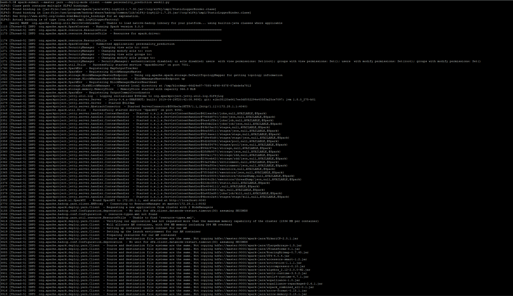
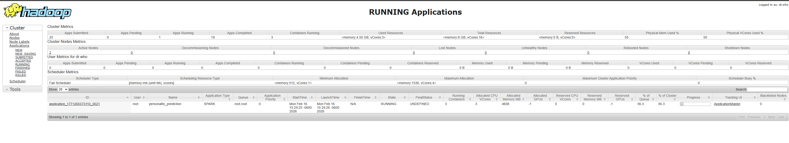

### 6. Verify Results in HBase

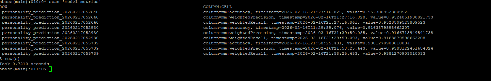


## Limitations

This pipeline lacks data quality and validation layers, as expected, since this project's focus is on setting up and running the pipeline. Without these layers, an upstream issue would cause the whole pipeline to fail. These are important layers to add if I were to convert the pipeline into production.
